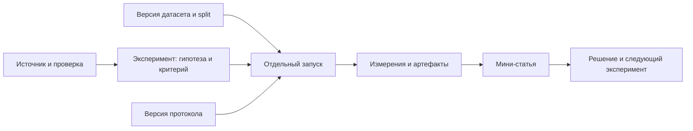

# Журнал экспериментов 3DGS в Smena

Историческое предложение от 17 ноября 2026 года. Реализация модуля начата по последующему согласованному плану из восьми этапов; актуальные возможности, сценарий 3DGS и ограничения описаны в [инструкции модуля](RESEARCH_MODULE.md). Ниже сохранено исходное предложение для контекста решений.

Основание: предоставленные пользователем `JOURNALING_RULES.md` и `JOURNALING_RULES.html`, версия 1.1. HTML представляет тот же регламент в удобном для чтения виде. Ниже отделены требования регламента от предложений по реализации. Сами документы и их частные рабочие материалы не включены в публичную страницу продукта.

## 1. Модель работы

Smena стоит использовать как память и координационный центр исследования. Вычисления, обучение и тяжёлый рендеринг выполняются на вычислительных машинах; в Smena поступают паспорта, конфигурации, измерения, доказательства и выводы.

Основная цепочка:



Это следует из назначения и §1–3, §7–12 регламента. Эксперимент объединяет вопрос и сравнение, запуск — одну фактическую попытку с конкретным методом, seed и конфигурацией. Повтор создаёт новый запуск; прежние результаты не заменяются.

## 2. Требования регламента, которые необходимо сохранить

| Требование                                              | Значение для платформы                                                                                                                      |
| ------------------------------------------------------- | ------------------------------------------------------------------------------------------------------------------------------------------- |
| План до результата: гипотеза, baseline, критерий успеха | План фиксируется до начала запуска. Изменения после результата видны как отдельная версия                                                   |
| Раздельные состояния вычисления, проверки и доставки    | `planned/running/completed/failed/cancelled`, отдельные `review_status` и `sync_status`. Успешная загрузка не означает успешный эксперимент |
| Точный контекст воспроизводимости                       | Версии кода и весов, конфигурация, seed, оборудование, времена, датасет/split и ограничения                                                 |
| Проверяемые измерения                                   | Значение, единица, статус, причина отсутствия, scope, n, агрегация, protocol_id и ссылка на доказательство                                  |
| Пропуск не равен нулю                                   | `missing` и `not_applicable` сохраняют `null` и пояснение. Нулевые значения остаются настоящими измерениями                                 |
| Сопоставимость                                          | Сравнение только совместимых датасетов, split, разрешений и протоколов. Нет универсального порога PSNR для всех задач                       |
| Канонические исходники                                  | Одинаковые байты хранятся один раз по явной ссылке на артефакт. Производные содержат происхождение, SHA-256 и параметры преобразования      |
| Доказанная публикация                                   | Сохранить реальные ID, версии/ETag и хеши; полностью прочитать результат обратно. HTTP 200 сам по себе недостаточен                         |
| Восстановление доставки                                 | Стабильный operation_id, обработка uncertain и продолжение прежней операции без дублей                                                      |
| Источники проверяются по отдельным признакам            | Даты, глубина чтения, происхождение утверждения; доступность code/weights/demo/dataset/license проверяется раздельно                        |

Не следует сохранять секреты, запрещённые данные или скрытые рассуждения модели. Журнал содержит выполненные действия, наблюдения, результаты и основания решения.

## 3. Первый пилот на существующих возможностях

Предлагаю начать внутри проекта 3DGS с шести типов заметок и связанных файлов. Это **рекомендация**, а не готовая возможность специализированного научного журнала.

| Тип заметки             | Содержимое                                                             | Связи                                                         |
| ----------------------- | ---------------------------------------------------------------------- | ------------------------------------------------------------- |
| Источник                | Работа, авторы, даты, глубина чтения, проверенные ссылки и ограничения | Закладка, HTML-копия публичной страницы, PDF/код              |
| Датасет                 | Происхождение, версия, подготовка, SfM, split, права, manifest         | Канонические входы и проверки                                 |
| Эксперимент             | Вопрос, гипотеза, baseline/candidate, критерий успеха, план            | Источники, датасеты, запуски                                  |
| Запуск                  | Краткий паспорт фактического исполнения                                | experiment_id, dataset_version, protocol_id, файлы результата |
| Мини-статья             | Вывод, метод, таблица сравнения, evidence, ограничения, следующий шаг  | Запуски, артефакты, решение                                   |
| Исследовательский обзор | Интервал, timezone, фактическое время проверки, запросы и охват        | Источники, включения/исключения, непроверенные области        |

Шаблоны, папки, поиск, типы, свойства, связи и история Smena подходят для такого пилота. Холст помогает спланировать гипотезу, входы и сравнение; граф показывает происхождение материалов. Они не должны становиться единственным хранилищем измерений и не подтверждают научную корректность связей.

### Компактный паспорт запуска

В свойствах заметки достаточно 17 индексируемых полей:

1. run_id;
2. experiment_id;
3. режим;
4. состояние вычисления;
5. состояние проверки;
6. состояние доставки;
7. ответственный;
8. dataset_version_id;
9. split_id;
10. protocol_id;
11. code_revision;
12. weights_revision;
13. seed;
14. hardware_profile;
15. started_at;
16. finished_at;
17. ссылка на manifest результата.

Полные timestamps, структуры, массивы и опциональные значения остаются в JSON. Поля даты в существующих свойствах не следует выдавать за полноценное хранение UTC timestamp.

Текущие типы заметок ограничены 20 простыми полями: text, number, date, checkbox, member, project. Они не хранят вложенные метрики, массивы или `null`. Поэтому помещать все измерения в пользовательские свойства сейчас нельзя.

## 4. Пакет одного запуска

Предлагаемая структура:

```text
run-<stable-id>/
  run.json
  config.json
  dataset-manifest.json
  metrics.json
  artifacts.json
  article.md
  article.html
  evidence/...
```

`artifacts.json` содержит роль, имя, формат/версию, размер, SHA-256, Smena file_id, исходные артефакты и преобразование. Ссылки на большие исходники могут указывать на уже загруженные канонические файлы. Автоматическая глобальная дедупликация сейчас не гарантируется.

PLY, SOG, checkpoints и дополнительные входы включаются, когда применимы и нужны для воспроизведения. Не нужно создавать фиктивную модель или checkpoint для операции, которая их не производит. Gaussian PLY, point-cloud PLY и mesh PLY — разные роли.

Per-view/per-scene таблицы лучше сохранять JSON/CSV, отдельно от компактной заметки. Мини-статья строится по проверенным данным: **вывод → условия → baseline/candidate/delta → доказательства → ограничения → следующий эксперимент**.

## 5. Представления и повседневный сценарий

Предлагаю вкладку «Исследования» внутри проекта, а не ещё один постоянный пункт общего меню. Для пилота её может заменить сохранённая подборка заметок.

1. Исследователь создаёт эксперимент по короткому шаблону и связывает источник, версию датасета и протокол.
2. До старта фиксирует baseline, гипотезу и критерий успеха.
3. Создаёт отдельный запуск. Вычислительный процесс получает стабильный run_id.
4. По завершении загружает пакет через очередь файлов или интеграцию. Доставка проверяет размер, хеш, связи и полное обратное чтение.
5. Рецензент проверяет измерения и ограничения. Состояние проверки независимо от состояния вычисления.
6. Сравнение показывает только совместимые запуски. Несовместимость объясняется: например, «Разный test split», а не скрывается пустой таблицей.
7. Из результатов формируется редактируемая мини-статья; решение связывается со следующей задачей или экспериментом.

На телефоне по умолчанию нужен список запусков: название, состояние, метод, датасет и последнее действие. В записи — вывод и три независимых статуса; полные конфигурации и большие таблицы раскрываются по необходимости. Холст и граф дополняют список, но не являются обязательным шагом.

Для обзоров отдельно сохраняются полуоткрытый интервал `[from, to)`, timezone и реальное время выполнения. Охват имеет состояния complete/partial/blocked/not_run; отсутствие результатов нельзя автоматически трактовать как отсутствие публикаций.

## 6. Протоколы для 3DGS

Обязательность полей зависит от режима, как требует регламент:

- Подготовка датасета: eligible/registered counts, связность, reprojection error с определением, масштаб, split, время и ресурсы. При нулевом знаменателе ratio отсутствует с причиной.
- Оптимизация сцены: итерации, active train time, densification/pruning, Gaussians, VRAM/RAM, критерий остановки и итоговый экспорт.
- Feed-forward inference: revision/хеш весов, входные views, posed/RGB-only, cold/warm latency, throughput и память. Это не называется обучением.
- Finetuning/foundation training: исходные веса, обучаемые компоненты, corpus/split, leakage assessment, schedule, precision и измеренные GPU-hours.
- Качество RGB: PSNR/SSIM/LPIPS при зафиксированных held-out views, разрешении, масках, background, colorspace и реализациях. Сначала per-view, затем согласованная агрегация.
- Геометрия/4D: GT, единицы, alignment, временной split и ограничения метода оценки. Статичная картинка не доказывает временную устойчивость.
- Рендеринг: одинаковый camera path, устройство, renderer/browser, warmup/sample count, frame time p50/p95 и время первого кадра.
- Конвертация/сжатие: before/after bytes, codec/version, encode/decode time и quality delta при одинаковых видах.

Число повторов, uncertainty и неудачные запуски сохраняются. Если применимы стохастические сравнения, регламент рекомендует несколько seed; интерфейс должен показывать фактическое n, а не обещать статистическую достоверность автоматически.

## 7. Что потребуется сверх текущей платформы

| Доработка                                         | Причина                                                                                                                 |
| ------------------------------------------------- | ----------------------------------------------------------------------------------------------------------------------- |
| Валидируемый research manifest и схемы метрик     | Простых свойств заметки недостаточно для научного контракта                                                             |
| Неизменяемые версии датасета и протокола          | Нельзя менять условия старого сравнения задним числом                                                                   |
| Проверка совместимости и таблица сравнения        | Граф показывает связи, но не проверяет сопоставимость                                                                   |
| Постоянный журнал доставки                        | Нынешние квитанции API хранятся 24 часа, до 500 записей; для долгого исследования нужен отдельный долговременный реестр |
| Исследовательские операции API/MCP                | Текущие инструменты ориентированы на заметки и файлы; CRUD экспериментов/протоколов/измерений ещё нет                   |
| Предпросмотр PLY/SOG при подтверждённой поддержке | Сейчас нельзя обещать универсальный интерактивный Gaussian viewer                                                       |

Обычный импорт MD/TXT не восстанавливает произвольные типы и свойства. Для пилота потребуется отдельный импорт исследовательского пакета либо использование родного ZIP знаний, который сохраняет структуру заметок. Проверка протокола не должна зависеть от текста, сгенерированного ИИ.

## 8. Предлагаемые этапы и критерии готовности

**Этап 1 — пилот:** согласовать шесть шаблонов, паспорт запуска и JSON-схемы; провести один небольшой воспроизводимый эксперимент. Никакой новой общей навигации и вычислений на сервере приложения.

**Этап 2 — надёжный приём:** импорт пакета, проверка хешей/ID/протоколов, полное обратное чтение, восстановление uncertain и постоянные квитанции.

**Этап 3 — исследовательский интерфейс:** список запусков, фильтры, совместимые сравнения, независимое рецензирование и мини-статья.

**Этап 4 — дополнительные инструменты:** scene viewer, сравнение изображений, профили оборудования и автоматизация вычислительных машин с отдельным явным разрешением.

Пилот считается успешным, когда другой сотрудник может по записи восстановить входы и условия, отличить отсутствие измерения от нуля, проверить evidence, повторить запуск без перезаписи прошлых результатов и продолжить оборванную доставку без дублей. Пакет должен экспортироваться и проверяться независимо от доступности Smena.

До внедрения стоит согласовать ответственного за рецензирование, список первых режимов 3DGS, размер/расположение канонических датасетов, политику хранения checkpoints и первый тестовый эксперимент. Это проектные решения для следующего этапа, а не блокировка текущих UI-правок.
