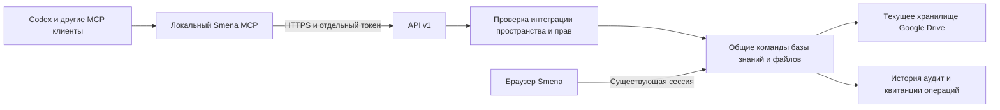

# План внедрения API базы знаний и MCP для Smena

Дата: 16 ноября 2026 года. Основа: предложение `Smena-API-design.zip` и код Smena в коммите `b06c4ec3cab652f1a537f688bc924decb19567bd`.

Предлагаю внедрить внешний API базы знаний и локальный MCP-сервер. Первым клиентом будет Codex; HTTP-контракт и MCP-инструменты должны оставаться пригодными для других клиентов. Пользователь сможет поручить ассистенту найти материалы, прочитать заметку, создать новую или обновить существующую с сохранением истории и защитой от потери чужих изменений.

Архитектура предложения подходит Smena. Основная работа — выделить общие серверные команды, добавить отдельные полномочия интеграций и гарантии повторной записи. Google-вход, Google Drive и существующая модель пространств сохраняются. Первый полезный выпуск — чтение и поиск из Codex; запись и большие вложения вводятся следующими этапами.

## Состав предложения и границы внедрения

Архив содержит черновой HTTP-контракт, интерактивную схему, её JSON-источник, README и пример статьи `IMG_0244-result-6002.md`. Автор прямо указывает, что исследовал интерфейс, а не серверную реализацию. Методы `/api/v1` из архива являются предложением.

Статья служит примером для проверки сохранения Markdown. Её импорт, публикация упомянутой модели около 1,46 ГБ и выдача токенов не входят в подготовку этого плана. Внутренние пути из статьи не следует переносить в общедоступные примеры и диагностические журналы.

В первый законченный текстовый выпуск входят:

- отдельный отзываемый токен для одной интеграции и одного пространства;
- получение контекста, папок, типов заметок, поиск, чтение заметки и доступной истории;
- создание заметки, изменение содержимого и разрешённых свойств;
- проверка версии, защита от повторов, журнал действий и каноническая ссылка на результат;
- локальный MCP через stdio, инструкция и проверка подключения в Codex;
- управление интеграциями в настройках на русском и английском, включая мобильную версию.

После текстового выпуска — загрузка и привязка файлов. Отдельными последующими задачами остаются удаление, массовые изменения, управление правами, создание типов и папок, восстановление версий через MCP, инструменты задач/холстов/графа и удалённый MCP с OAuth.

## Что уже есть в Smena

| Область           | Подтверждено в коде                                                                                                  | Что требуется добавить                                                                                              |
| ----------------- | -------------------------------------------------------------------------------------------------------------------- | ------------------------------------------------------------------------------------------------------------------- |
| Вход              | Google-вход, подписанные браузерные сессии и серверный реестр сессий                                                 | Независимые токены интеграций, срок действия, scopes и отзыв                                                        |
| Пространства      | Каталог пространств, проверка участника и контекст через AsyncLocalStorage; исходное пространство имеет ID `default` | Однозначное сопоставление ID в публичном URL, токене и серверном контексте                                          |
| Чтение заметки    | `readKnowledgeNote`, отдельная загрузка тела, hash заметки и ревизия документа базы знаний                           | Стабильный внешний DTO и ограниченное чтение длинного текста                                                        |
| Изменение заметки | `patchKnowledgeNote`, проверка ожидаемого hash внутри записи, валидация, история и обновление wiki-ссылок            | Общие команды создания и изменения, версия публичной сущности, HTTP preconditions                                   |
| Создание и импорт | Серверные операции каталога и отдельный механизм импорта                                                             | Команда создания одной заметки без передачи всего каталога внешнему клиенту                                         |
| Поиск             | Серверный холодный поиск по производному индексу, фильтрация до выдачи фрагментов                                    | Публичная пагинация, ограниченные ответы и единая проверка полномочий интеграции                                    |
| История           | Внешние blobs версий; предел до 20 версий и объединение частых сохранений одного редактора                           | Различение пользователя и интеграции, отдельный аудит операций; история не является полным журналом каждого запроса |
| Хранилище         | Общая очередь записи, immutable-части и условная публикация корня Google Drive                                       | Атомарная фиксация результата API, аудита и квитанции повторного запроса в том же механизме                         |
| Файлы             | Возобновляемая загрузка в Drive, tickets, проверка назначения и финализация                                          | Контракт для интеграции, привязка к проекту, проверка SHA-256 и разрешённое скачивание                              |

В `knowledgeActor` доступ к заметкам проверяется по активному членству и роли в пространстве. Этот механизм сам по себе не предоставляет готовую отдельную ACL каждой папки. У файлов есть дополнительные проверки доступа к проекту. Фильтр папки в поиске нельзя представлять пользователю как ограничение полномочий токена.

Основные точки повторного использования:

- [Маршруты приложения](../src/server/app.js), [вход](../src/server/auth.js), [контекст пространства](../src/server/workspace-directory.js).
- [Проверка доступа к знаниям](../src/server/knowledge-access.js), [чтение и изменение заметки](../src/server/knowledge-note-store.js).
- [Изменение каталога](../src/server/knowledge-catalog-write.js), [дельты каталога](../src/server/knowledge-catalog-delta.js), [импорт](../src/server/knowledge-import-store.js).
- [Холодный поиск](../src/server/knowledge-search-query.js), [история](../src/server/knowledge-version-blobs.js), [транзакционный путь записи](../src/server/workspace-store.js).
- [Маршруты файлов](../src/server/file-routes.js), [Google Drive](../src/server/storage/google-drive.js), [политика файлов](../src/server/file-policy.js).

## Целевая архитектура

MCP преобразует вызовы инструментов в API-запросы. Он не содержит независимые правила доступа и не записывает данные напрямую в Drive. Новая база данных и отдельный процесс записи в Drive для первого выпуска не требуются.

Локальный сервер запускается клиентом как subprocess через stdio; публичный порт на компьютере пользователя не нужен. Диагностика идёт в stderr, stdout используется для протокола. Эти правила соответствуют [документации MCP](https://modelcontextprotocol.io/docs/develop/build-server) и [описанию транспортов](https://modelcontextprotocol.io/specification/latest/basic/transports).

## Необходимые уточнения контракта

### Авторизация интеграций

1. Создавать отдельный случайный секрет для каждой интеграции. На сервере хранить проверочный hash, ID, владельца, пространство, scopes, время создания, истечения и отзыва. Полный секрет показывать один раз.
2. Начальные scopes: `knowledge:read`, `knowledge:write`, затем `files:read`, `files:write`. Запись не выдавать автоматически. Для обновления из MCP запрашивать и чтение, и запись.
3. Эффективный доступ всегда равен пересечению scopes токена и текущих прав пользователя. Удалённый участник, viewer и архивированное пространство не получают прежние полномочия по старому токену.
4. Участник может создать интеграцию для себя в доступном пространстве в рамках своей роли. Общие интеграции от имени всей команды в MVP не вводить. Администратору дать возможность отзыва интеграций пространства.
5. Реестр интеграций хранить отдельно от экспортируемого содержимого пространства. Восстановление резервной копии заметок не должно восстанавливать отозванные токены. Переиспользовать подход приватного реестра сессий, не помещая новые записи в список браузерных сессий с лимитом 500.
6. `/api/v1` подключить с собственной авторизацией до общего браузерного `requireAuth`. Токен интеграции не должен открывать старые маршруты `/api/workspace`, резервные копии и административные функции.
7. Для пути `{workspace_id}` использовать серверный ID, включая `default`, а не название или slug. Запретить переопределение пространства заголовком или query. Чужой ID не должен раскрывать существование объекта.
8. Проверять права не только при входе в маршрут, но и перед фиксацией записи. Запрос, начатый после успешного отзыва токена, обязательно отклонять; для уже выполняющегося запроса определить порядок завершения и отзыва, не обещая отмену уже сохранённого изменения.

API принимает Bearer по HTTPS без подмены его браузерной cookie. Секрет не передаётся в query. MCP использует настроенный адрес Smena и не пересылает Authorization при перенаправлении на другой origin; HTTP допускается только для явно выбранной локальной разработки.

Для MVP права распространяются на всё разрешённое пространство, что нужно явно написать в форме выдачи токена. Ограничение отдельными папками добавлять только после сквозной проверки поиска, истории, ссылок, переносов и вложений. Для первого подключения удобно использовать личное или тестовое пространство.

### Версии и совместная работа

`noteHash` уже защищает текущий путь изменения, но это не готовый монотонный `version` из черновика. Ревизия всей базы знаний также не является версией одной заметки.

Перед включением внешней записи нужно ввести серверную версию заметки и сильный ETag. Число `version` увеличивается при изменении внутри поколения; ETag включает ID, поколение и версию. Учесть все пути изменения: одиночное редактирование, каталог, импорт, восстановление, офлайн-синхронизацию и перенос. Для восстановления резервной копии предусмотреть смену поколения версий, чтобы старый ETag не стал действительным снова. Миграцию выполнять без загрузки всех тел заметок при каждом запросе.

Клиент читает заметку, отправляет изменение с `If-Match` и получает новую версию. Несовпадение возвращает `412`, отсутствие обязательного условия — `428`. Устаревшую полную замену текста автоматически повторять нельзя. Поведение опирается на [RFC 9110](https://www.rfc-editor.org/rfc/rfc9110.html#name-if-match) и [RFC 6585](https://www.rfc-editor.org/rfc/rfc6585.html#section-3).

Создание, история, wiki-ссылки, индекс и проверка версии должны проходить через общие серверные команды. Отдельно проверить старый браузер с локальным черновиком: его синхронизация не должна молча затереть результат MCP. CRDT для этой функции добавлять не требуется.

### Повторы и атомарность

Для создания, изменения и привязки вложения обязателен `Idempotency-Key`. Область ключа: ID интеграции + пространство; отпечаток включает метод, канонический путь и нормализованное тело запроса.

- Одинаковый ключ и запрос возвращают первоначальный результат без новой заметки, версии и audit event.
- Тот же ключ с другими данными возвращает `409`.
- После timeout клиент повторяет тот же запрос с тем же ключом. Новый ключ означает новую операцию.
- Квитанция с версией и ID результата сохраняется вместе с изменением и аудитом при одной публикации корня хранилища. Отдельный JSON-файл, записанный после заметки, эту гарантию не обеспечивает.
- При повторе сначала проверить текущий токен и доступ, затем найти квитанцию и только для новой операции проверять `If-Match`. Иначе успешный повтор ошибочно получит конфликт по старой версии.
- Предлагаемый срок хранения ключа — 24 часа. После этого автоматическую повторную запись не выполнять; сначала выяснить состояние операции. Ограничить число квитанций и их объём, предусмотреть очистку без включения отключённого планировщика уведомлений.

При заполнении лимита квитанций отклонять новые записи с понятной ошибкой, сохраняя обещанный срок уже принятых ключей. MCP сохраняет устойчивый ID операции до отправки запроса и использует его при сетевых повторах. После рестарта MCP неопределённые операции сначала сверяются по ID; перезапуск не должен превращать повтор в новое создание. Локальное состояние операций хранится приватно, без токенов и текста заметок. Если для продолжения нужен прежний текст, его запрашивают заново и сверяют отпечаток; разные намеренные создания одинакового текста остаются разными операциями.

Нужно расширить текущие допустимые metadata scopes и формат хранилища для аудита и квитанций. Исторические blobs могут записываться заранее, но ссылку на них, заметку и результат операции следует публиковать вместе. Аудит содержит автора, интеграцию, request ID, ID заметки, версии до/после и время; секреты и полный текст в него не попадают.

### Markdown и объём ответов

Зафиксировать UTF-8 и правила переводов строк. Hash содержимого считать по сохранённым байтам Markdown и возвращать рядом с результатом. Поля `content_markdown`, `folder_id`, `type_id` преобразовывать в существующие поля Smena только в адаптере API. ID типов и свойства проверять по текущей схеме; неизвестные поля отклонять.

Поиск выдаёт названия, ID, короткие фрагменты, версию и ссылку. Чтение поддерживает ограниченный фрагмент и продолжение, привязанное к той же версии. При изменении текста между фрагментами клиент должен начать чтение новой версии. История сначала возвращает метаданные, содержимое версии читается отдельно.

Стартовые проектные ограничения: 20 результатов поиска по умолчанию, максимум 50; до 32 КиБ текста за вызов MCP. Это предлагаемые значения для проверки, а не действующие лимиты сайта. HTTP-лимит заметки нужно согласовать с существующим JSON-лимитом транспорта и лимитом сериализованного тела; не обещать приём 8 МиБ Markdown только по размеру body blob.

Содержимое заметки является данными. Инструкция внутри заметки не разрешает запуск команд, чтение локальных секретов или отправку других документов. MCP не должен предоставлять универсальные инструменты выполнения кода, запросов к произвольному URL или прямого доступа к Drive.

## Предлагаемый API и инструменты

Все пути ниже начинаются с `/api/v1`. Это целевой контракт, который нужно описать в OpenAPI до реализации.

| HTTP  | Путь                                              | MCP инструмент                   | Выпуск                                                  |
| ----- | ------------------------------------------------- | -------------------------------- | ------------------------------------------------------- |
| GET   | `/me`                                             | `get_context`                    | Чтение                                                  |
| GET   | `/workspaces`                                     | `list_workspaces`                | Чтение; токен MVP видит только привязанное пространство |
| GET   | `/workspaces/{w}/folders`                         | `list_folders`                   | Чтение                                                  |
| GET   | `/workspaces/{w}/note-types`                      | `list_note_types`                | Чтение                                                  |
| GET   | `/workspaces/{w}/notes`                           | `search_notes`                   | Чтение; cursor, query, folder, limit                    |
| GET   | `/workspaces/{w}/notes/{id}`                      | `read_note`                      | Чтение; метаданные и ограниченный текст                 |
| GET   | `/workspaces/{w}/notes/{id}/revisions`            | `list_note_revisions`            | Чтение                                                  |
| GET   | `/workspaces/{w}/notes/{id}/revisions/{revision}` | `read_note_revision`             | Чтение                                                  |
| POST  | `/workspaces/{w}/notes`                           | `create_note`                    | Запись                                                  |
| PUT   | `/workspaces/{w}/notes/{id}/content`              | `update_note_content`            | Запись с If-Match                                       |
| PATCH | `/workspaces/{w}/notes/{id}/metadata`             | `update_note_metadata`           | Запись с If-Match                                       |
| GET   | `/workspaces/{w}/operations/{operation_id}`       | `get_operation_status`           | Запись; сверка неопределённого результата               |
| GET   | `/workspaces/{w}/files/{id}`                      | `read_file_metadata`             | Вложения                                                |
| GET   | `/workspaces/{w}/files/{id}/content`              | Отдельное разрешённое скачивание | Вложения                                                |
| POST  | `/workspaces/{w}/uploads`                         | `begin_upload`                   | Вложения                                                |
| GET   | `/workspaces/{w}/uploads/{upload_id}`             | `get_upload_status`              | Вложения                                                |
| POST  | `/workspaces/{w}/uploads/{upload_id}/complete`    | `complete_upload`                | Вложения                                                |
| POST  | `/workspaces/{w}/notes/{id}/attachments`          | `attach_file`                    | Вложения с If-Match                                     |

У cursor должны быть срок действия, стабильный порядок и привязка к запросу, пространству и разрешениям. Изменение каталога между страницами должно приводить к определённому контрактом поведению, например к необходимости начать поиск заново. Не передавать наружу внутренние массивы совпадений, профили участников и root manifest.

Ошибки имеют стабильные `code`, безопасное `message`, `request_id` и при необходимости разрешённую текущую версию. Использовать `401/403/404`, `409`, `412`, `413`, `422`, `428`, `429` с `Retry-After`. Ограничения частоты и параллельных операций устанавливать отдельно для токена и пространства, проверять их после рестарта.

## Подключение Codex и совместимость

Предлагаемый MCP-пакет — отдельный пакет Node.js в `packages/smena-mcp`, использующий официальный SDK с зафиксированной версией и lockfile. Бизнес-правила остаются на сервере Smena. Версию протокола выбрать по совместимости с установленным Codex и вторым клиентом; не привязывать весь продукт к особенностям одного хоста.

Для Codex подготовить установку проверенного локального пакета, команду запуска и конфигурацию без секретов. Пользовательский токен хранить в Windows Credential Manager, а на других поддержанных ОС — в штатном хранилище секретов. Обёртка MCP читает его при запуске. Если хранилище недоступно, не переходить незаметно к хранению открытого токена в файле; показать понятную ошибку или предложить явно выбранный временный способ через окружение.

В конфигурации клиента остаются только команда, путь к пакету, адрес Smena и несекретное имя профиля. Не помещать токен в аргументы командной строки, репозиторий или ответы инструментов. Поддержку stdio и настройку через `config.toml` подтверждают локальный `codex mcp add --help` и [официальная документация Codex](https://developers.openai.com/codex/mcp).

Для нескольких клиентов предусмотреть:

- одинаковые имена инструментов, JSON Schema и структурированные результаты;
- отдельный токен на каждую клиентскую интеграцию, даже если пакет один;
- полный сценарий в Codex и таком же втором клиенте, например Claude Desktop;
- проверку запуска пакета на Windows, macOS и Linux по мере объявления их поддержки;
- обработку отмены, timeout, недоступности сети и отключения интеграции;
- отдельные инструменты чтения и записи с корректными MCP annotations; annotations помогают интерфейсу клиента, но не заменяют серверные права.

Удалённый Streamable HTTP MCP потребуется для клиентов, которые не могут запускать локальный процесс. Это следующий выпуск со своей авторизацией и моделью развёртывания; URL обычного REST API нельзя просто указать как MCP endpoint.

## Вложения и большие файлы

Новая загрузка должна использовать существующий resumable-механизм. Google описывает восстановление прерванной передачи в [руководстве Drive](https://developers.google.com/workspace/drive/api/guides/manage-uploads).

В текущей модели файл принадлежит проекту. Поэтому запрос создания upload обязан содержать разрешённый `project_id` и при необходимости папку файлов; папка заметок является другой сущностью. Права на заметку не дают права на закрытый файл. При привязке и скачивании проверять обе стороны, не раскрывать метаданные недоступного файла через Markdown, ссылки и историю.

Сессия связывается с интеграцией, пользователем, пространством, проектом, размером и именем. Возобновление использует тот же upload ID и подтверждённое провайдером смещение. Ключи, upload URL и локальные пути не должны попадать в модельный контекст и обычные журналы. Для передачи с диска использовать отдельную локальную команду с разрешённым файлом/каталогом, а в MCP возвращать только состояние и ID файла. Не читать произвольный путь, предложенный текстом заметки.

`verifyResumableUpload` сейчас проверяет ID, имя, размер, папку и marker; этого недостаточно для обещания проверки SHA-256. Нужно запрашивать checksum у Drive и сравнивать с ожидаемым hash. Поле `sha256Checksum` доступно для бинарных файлов, когда провайдер его предоставляет, что оговорено в [справочнике Drive](https://developers.google.com/workspace/drive/api/reference/rest/v3/files). Если checksum отсутствует, файл остаётся в состоянии проверки до независимой потоковой проверки; объявлять успешную SHA-256-проверку по одному клиентскому значению нельзя.

В исходниках default верхнего лимита файла составляет 20 ГиБ с возможностью настройки. Реальный предел на smena.team, квоту Drive и доступность direct upload проверить перед испытанием модели 1,46 ГБ. Большой файл не передавать через JSON, base64, tool result или буфер памяти размером с файл.

Отзыв интеграции должен блокировать завершение и привязку upload. Уже выданный Drive resumable URL является отдельным разрешением и может продолжить принимать байты после отзыва токена; это нужно учесть в сроках жизни, квотах и уборке неподтверждённых файлов. Очистку выполнять существующим механизмом удержания и сверки, без немедленного удаления при неопределённом результате сохранения каталога.

## Интерфейс управления интеграциями

Разместить функцию в настройках пространства в блоке «Интеграции». Список показывает название, владельца, доступ, срок действия, последнее использование и состояние. Секрет повторно не отображается.

Сценарий подключения: выбрать пространство → «Подключить приложение» → название и права → однократное получение токена → настройка клиента → проверка подключения. По умолчанию выбран режим чтения; изменение заметок и файлов включается отдельно. Кнопка проверки ничего не создаёт и не отправляет содержимое заметок.

| Русский                                                         | English                                                       |
| --------------------------------------------------------------- | ------------------------------------------------------------- |
| Подключить приложение                                           | Connect an app                                                |
| Только чтение                                                   | Read only                                                     |
| Создание и изменение заметок                                    | Create and edit notes                                         |
| Доступ ко всем заметкам этого пространства                      | Access to all notes in this workspace                         |
| Скопируйте токен сейчас. Повторно показать его нельзя           | Copy this token now. It cannot be shown again                 |
| Проверить подключение                                           | Test connection                                               |
| Отключить интеграцию                                            | Disconnect integration                                        |
| Заметка изменилась. Прочитайте текущую версию перед сохранением | This note has changed. Read the current version before saving |

В истории отображать «Пользователь · Codex» или фактическое имя другой интеграции. Использовать существующие компоненты, токены дизайна и механизм локализации. На телефоне управление интеграциями и просмотр результата остаются полноценными; локальный MCP работает на устройстве, где запущен соответствующий клиент.

## Этапы внедрения

| Этап                        | Конкретные работы                                                                                                                   | Критерий готовности                                                                                                        |
| --------------------------- | ----------------------------------------------------------------------------------------------------------------------------------- | -------------------------------------------------------------------------------------------------------------------------- |
| 1. Контракт и модель данных | Зафиксировать OpenAPI, DTO, scopes, лимиты, версии, сроки квитанций; перечислить все пути записи и миграции                         | Согласованные примеры создания, конфликта и повтора; таблица преобразования существующих полей; схема совместимой миграции |
| 2. Общие команды            | Выделить создание и изменение одной заметки, подключить версии ко всем существующим путям, сохранить историю, индексы и wiki-ссылки | Браузерные сценарии проходят; старый офлайн-клиент не перезаписывает новую запись                                          |
| 3. Интеграции               | Приватный реестр токенов, отдельный middleware, управление и отзыв RU/EN                                                            | Проверены роли, отзыв, истечение, чужое пространство и недоступность старого API по новому токену                          |
| 4. API чтения               | Контекст, папки, типы, поиск, заметки, история и ограниченные ответы                                                                | Контрактные тесты, изоляция, длинные MD, холодный поиск и cursor; запись ещё выключена                                     |
| 5. MCP чтения и Codex       | Пакет stdio, хранилище секретов, установка, тест второго клиента                                                                    | Codex ищет и читает заметки; тот же сервер проходит сценарий второго клиента; секрет не появляется в выводе                |
| 6. API и MCP записи         | If-Match, квитанции, аудит, создание/изменение, состояние операции                                                                  | Гонки и сбои не теряют изменения и не создают дубликаты; read-back подтверждает результат                                  |
| 7. Файлы                    | API поверх текущих uploads, проектные права, checksum, resume, привязка и скачивание                                                | Передача большого файла продолжается после сбоя; чужой файл не раскрывается; повтор complete/attach безопасен              |
| 8. Выпуск                   | Проверки RU/EN и адаптивности, документация, наблюдаемость, ограниченное включение                                                  | Smoke на smena.team в тестовом пространстве, проверки отключения и отката без восстановления старого содержимого           |

Ранний полезный выпуск заканчивается этапом 5 и даёт поиск/чтение в Codex. Полный текстовый MVP заканчивается этапом 6. Загрузка модели и других крупных вложений начинается только на этапе 7.

Предлагаемые новые артефакты: `docs/api/openapi.yaml`, спецификация полномочий, модули integration auth и API v1, общие команды заметок, `packages/smena-mcp`, инструкции подключения и отдельные контрактные тесты. Это планируемые файлы, а не уже существующая реализация.

Для последовательной работы разбить внедрение на небольшие коммиты: контракт → версии → общие команды → реестр токенов → UI интеграций → чтение API → MCP чтения → атомарные квитанции/аудит → запись API/MCP → вложения → эксплуатационная документация и финальная проверка. Проверки добавлять в те же изменения, которые вводят соответствующее поведение. Каждый этап публиковать с выключенными новыми возможностями до прохождения его критериев.

## Проверки перед включением

| Направление       | Обязательные сценарии                                                                                                                                                                     |
| ----------------- | ----------------------------------------------------------------------------------------------------------------------------------------------------------------------------------------- |
| Доступ            | admin/editor/viewer, личное и общее пространство, `default` и UUID, удалённый участник, архив, истёкший/отозванный токен, ID из другого пространства, попытка подмены заголовка           |
| Полномочия        | read-token не пишет; новый токен не открывает browser/admin API; результат поиска, история, ошибки и файловые ссылки не раскрывают недоступные данные                                     |
| Совместная работа | UI и MCP сохраняют одновременно; параллельные запросы к одной заметке; обновление другой заметки; старый офлайн-черновик; восстановление версии и резервной копии                         |
| Надёжность записи | Два одинаковых POST одновременно; другой payload с тем же ключом; рестарт после фиксации до ответа; повтор с прежним If-Match; истечение квитанции; отзыв перед повтором                  |
| Markdown          | Статья из архива, кириллица, таблицы, CRLF/LF, emoji; отдельные синтетические примеры code fences, wiki-ссылок и опасного HTML; сравнение сохранённого текста и hash                      |
| Объём             | Большая заметка, ограниченные фрагменты, история, большой каталог и холодный поиск; нет чтения всей библиотеки ради одного запроса и роста root metadata без ограничения                  |
| Файлы             | Малый служебный файл, затем большой файл; обрыв и рестарт клиента; checksum mismatch; законченная передача с потерянным ответом; отзыв токена; недоступный проект; повтор complete/attach |
| Клиенты           | Реальное подключение Codex; второй клиент; запуск/перезапуск, отмена и timeout, чистый stdout, отсутствие токена в трассах и tool result                                                  |
| UI                | RU/EN; ширины 320, 390, 768, 1366 и 1920 px; длинные названия интеграций, клавиатура, focus, копирование секрета, отключение, понятные ошибки                                             |
| Развёртывание     | Nginx и systemd не ломают пути/тайм-ауты; feature flags выключают чтение/запись отдельно; восстановление содержимого не оживляет токены; Google-вход и текущий Drive продолжают работать  |

Статья из архива содержит таблицы и кириллицу, но не содержит code fences и wiki-ссылок: для этих проверок требуются отдельные примеры. Испытания записи сначала проводить локально, затем в отдельном тестовом пространстве. На production использовать служебные материалы в согласованных границах, не содержимое рабочих заметок команды.

## Порядок включения и отката

Ввести независимые выключатели внешнего API, записи и загрузок. Сначала включить чтение для тестовой интеграции, затем запись в тестовом пространстве, после проверки — выдачу интеграций пользователям. Собирать частоту ошибок, конфликты, повторы, длительность и размер запросов без содержимого документов и секретов.

При проблеме отключить соответствующие маршруты и при необходимости отозвать токен. Уже созданные заметки и версии сохраняются. Откат приложения допустим только на версию, совместимую с новой схемой; восстановление старого содержимого Drive не является способом отката API. Новые части хранилища и metadata должны корректно сохраняться при старых поддерживаемых путях записи.

Первое практическое действие — подготовить контракт и схему версий, затем выделить общую команду создания заметки. Выдачу токенов и подключение Codex начинать после проверки изоляции маршрутов и реестра интеграций.
